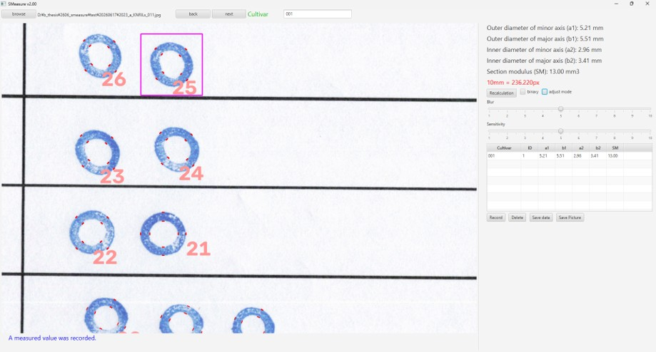

# SMeasure

**Version 2.01**

SMeasure is a GUI application that measures the outer and inner diameters of culm (stem) cross-sections from scanned images of ink stamps, and calculates the **section modulus (SM)**, a key indicator of culm thickness and lodging resistance in rice and other plants with hollow stems.



## Table of contents
- [Background](#background)
- [Features](#features)
- [Requirements](#requirements)
- [Installation](#installation)
- [Preparing input images](#preparing-input-images)
- [Usage](#usage)
- [Keyboard shortcuts](#keyboard-shortcuts)
- [Output files](#output-files)
- [How it works](#how-it-works)
- [Test data](#test-data)
- [Update history](#update-history)
- [Citation](#citation)
- [License](#license)
- [Contact](#contact)

## Background
The culm strength of rice is evaluated by the bending moment at breaking (BM), which is the product of the section modulus (SM, culm thickness) and the bending stress (BS, stiffness of the culm material): **BM = SM × BS**. SM is calculated by approximating the culm cross-section as a hollow ellipse:

```
SM = (π / 32) × (a1³ × b1 − a2³ × b2) / a1
```

- `a1`: outer diameter of the minor axis
- `b1`: outer diameter of the major axis
- `a2`: inner diameter of the minor axis
- `b2`: inner diameter of the major axis

Rice culms are soft and deform easily. A common approach is to stamp the cut surface of each culm onto paper with ink and measure the stamp later. Measuring stamps with calipers takes a long time and gives different results depending on the person measuring. SMeasure automates this step: it detects every stamp in a scanned sheet and measures the four diameters with one fixed rule.

## Features
- Detects all stamped cross-sections in a scanned sheet (TIFF or JPEG) automatically.
- Measures the four diameters (a1, b1, a2, b2) and calculates SM for each stamp.
- The user selects which stamps to record, so failed or duplicate stamps can be skipped.
- Each record is saved with a sample ID typed by the user.
- Results, including SM, are saved as CSV. Annotated images showing which stamps were recorded are also saved.
- Steps through all images in a folder with the **next** / **back** buttons.
- Calibration with a 10-mm scale bar, or presets for 300 and 600 dpi.

## Requirements
- **Windows 10/11 (64-bit).** The distributed package contains Windows builds of JavaFX and the OpenCV native library, so it does not run on macOS or Linux.
- **Java 25 or later** (JDK or JRE)
  - Windows: https://download.oracle.com/java/25/latest/jdk-25_windows-x64_bin.exe

## Installation
1. Download the latest release from the [Releases](https://github.com/KChigira/SMeasure/releases) page and unzip it.
2. The folder contains:
   ```
   SMeasure201.jar        # application (includes JavaFX)
   SMeasure201.bat        # launcher for Windows
   opencv-500.jar         # OpenCV Java bindings
   opencv_java500.dll     # OpenCV native library (Windows x64)
   README_201.txt
   test_data_600dpi/
   ```
   Keep all files in the same folder.
3. Double-click `SMeasure200.bat`. It runs:
   ```
   java --enable-native-access=ALL-UNNAMED -Djava.library.path=. -cp "SMeasure201.jar;opencv-500.jar" application.MainLauncher
   ```
   If the application does not start, the error message remains in the command window.

## Preparing input images
1. Cut the culm at the internode to be measured and press the cut surface onto white paper with **blue ink**. The program extracts blue ink, so black print and handwriting on the sheet are ignored.
2. Make several stamps per culm if needed. You choose the best one in the software.
3. Draw or print a 10-mm scale bar on the sheet if you will calibrate manually.
4. Scan the sheet. **600 dpi** is recommended. Lower resolution reduces accuracy.
5. Save as **TIFF** or **JPEG**. Avoid strong JPEG compression.

## Usage
1. Click **browse** and choose an image. All recognizable cross-sections are measured when the image is loaded (this may take several tens of seconds for large images). Each one is shown with its measurement lines and an index number.
2. **Calibrate.** Tick **adjust mode**, then either
   - drag from one end of the 10-mm scale bar to the other, or
   - press **3** (300 dpi) or **6** (600 dpi).
   The current scale is shown as `10mm = ... px`. Untick **adjust mode** when done.
3. Move around the image with **W / A / S / D**. Press **T** to jump to the bottom-right corner.
4. Type the sample name (e.g. cultivar or line ID) in the **Cultivar** box.
5. **Click a stamp** to select it. It is outlined in magenta and its a1, b1, a2, b2 and SM are shown on the right. Check that the red lines match the outer and inner edges.
6. Press **Record** or **X** to add the values to the table. Press **Delete** or **Q** to remove the last record. Press **Z** to record a blank row (e.g. a missing sample).
7. Click **Save data** to write the table to a CSV file. After the first save, the same file is overwritten each time.
8. Click **next** or **back** to load the next or previous image in the same folder (alphabetical order).

If stamps are not detected well:
- **Sensitivity** slider: raise it if faint stamps are missed; lower it if smudges are detected.
- **Blur** slider: raise it to smooth rough edges; lower it if thin walls merge.
- Click **Recalculation** after moving a slider.
- Tick **binary** to see the binarized image the program uses.

Use the same Sensitivity and Blur settings within one experiment, because they affect where the boundary of each stamp is placed.

## Keyboard shortcuts
| Key | Action |
| --- | --- |
| W / A / S / D | Move display up / left / down / right |
| T | Jump to the bottom-right of the image |
| X | Record the selected stamp |
| Q | Delete the last record |
| Z | Record a blank row (all values 0.00) |
| 3 | Set scale to 300 dpi (adjust mode only) |
| 6 | Set scale to 600 dpi (adjust mode only) |

Keys do not work while the cursor is in the **Cultivar** text box. Click on the image first.

## Output files
**CSV file** (`Save data`)

| Column | Description |
| --- | --- |
| `name` | Text in the **Cultivar** box when the record was made |
| `ID` | Record number |
| `outer_short` | Outer diameter of the minor axis, a1 (mm) |
| `outer_long` | Outer diameter of the major axis, b1 (mm) |
| `inner_short` | Inner diameter of the minor axis, a2 (mm) |
| `inner_long` | Inner diameter of the major axis, b2 (mm) |
| `section_modulus` | Section modulus, SM (mm³) |

All values are rounded to two decimal places. SM is calculated from the unrounded diameters, so recalculating it from the rounded diameters in the CSV may give a slightly different last digit. Blank rows recorded with **Z** have all values 0.00.

**Annotated images.** When you load another image (browse / next / back), the image you were working on is saved as `<original file name>.jpg`. Every recorded stamp is outlined in magenta. The first time, you are asked to choose a folder for these images. Use them to check which stamp was recorded for each sample.

Note: records deleted with **Q** after moving to another image are removed from the table, but the outline remains in the annotated image that was already saved.

## How it works
1. The image is split into blue, green and red channels, and the green channel is subtracted from the blue channel to isolate blue ink.
2. The difference image is binarized (threshold set by **Sensitivity**).
3. The binary image is blurred (kernel size set by **Blur**), dilated once, eroded twice and binarized again to remove noise and smooth edges.
4. Outer contours larger than 1,000 pixels are taken as candidate cross-sections.
5. For each candidate, the minimum-area bounding rectangle is computed. The lines joining the midpoints of opposite sides give the outer diameters a1 and b1.
6. Each line is intersected with the binary image. A hollow section gives two wall segments per line. The inner diameter is the outer diameter minus the two wall widths. Candidates without two wall segments on both axes are discarded.
7. SM is calculated from the four diameters with the formula above.

Image processing uses OpenCV (`Core.split`, `Core.subtract`, `Imgproc.threshold`, `Imgproc.blur`, `Imgproc.dilate`, `Imgproc.erode`, `Imgproc.findContours`, `minAreaRect`, `Core.bitwise_and`).

## Test data
The `test` folder contains three sample images for trying SMeasure. Each is part of a sheet of rice culm cross-sections stamped with blue ink and scanned at 600 dpi.

| File | Stamps |
| --- | --- |
| `test/test_600dpi_01.jpg` | 8 |
| `test/test_600dpi_02.jpg` | 11 (one is cut off at the right edge) |
| `test/test_600dpi_03.jpg` | 12 |

To try them:
1. Start SMeasure and load `test_600dpi_01.jpg` with **browse**.
2. The images have no scale bar. Tick **adjust mode**, press **6** to set the scale to 600 dpi, and untick **adjust mode**.
3. Click a stamp, check the measurement lines, and press **X** to record it. Use **next** to move to the other images.
4. Click **Save data** to save the results as CSV.

The stamp cut off at the right edge of `test_600dpi_02.jpg` shows a case that should not be recorded.

## Update history
- 2026-11-20 v2.01: The saved CSV file now includes the section modulus (`section_modulus` column). Fixed an error that occurred when deleting a record (Q) right after loading another image or after recording an empty value (Z). Fixed a problem where deleting an empty value removed the outline of the previous measurement from the annotated image.
- 2026-06-16 v2.00: Updated to Java 25, JavaFX 25 and OpenCV 5.0.0. All on-screen text is now in English.
- 2022-09-20 v1.41: Fixed an error when a small smudge was recognized as a region.
- 2020-09-23 v1.40: Added support for JPEG images.
- 2019-09-13 v1.21: Works without a separate OpenCV installation.
- 2019-09-12 v1.20: Added output of annotated images.

## Citation
Comming soon...

SMeasure has been used in:
- Chigira K., Yamasaki M., Adachi S., Nagano J.A., Ookawa T. (2023) Identification of novel quantitative trait loci for culm thickness of rice derived from strong-culm landrace in Japan, Omachi. *Rice* 16: 4. https://doi.org/10.1186/s12284-023-00621-8

## License
MIT License. See [LICENSE](LICENSE).

## Contact
Koki Chigira, Graduate School of Agricultural and Life Sciences, The University of Tokyo
